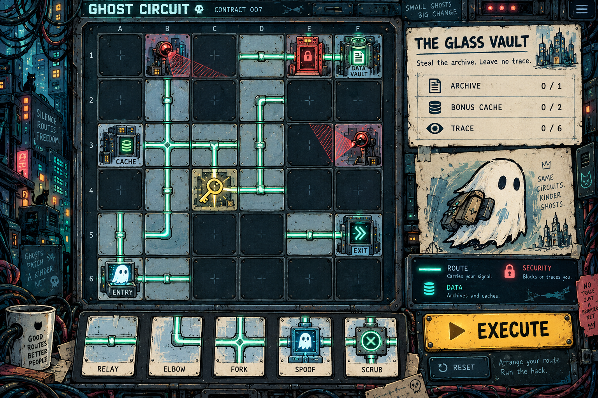

# Ghost Circuit — Design

Version and approval authority: [PRODUCT.md](PRODUCT.md). Five review revisions and M0 scope approved; complete-release content remains gated.

## 1. Direction and pillars

Ink-drawn cyberpunk hardware with worn paint, small city-like server structures, luminous cable routes, and a scrappy ghost courier. Mood: curious, illicit, playful. Avoid photorealism, glossy 3D and generic holographic dashboard clutter. Title is a working name. Flavor can be evocative; action labels and failure explanations must be plain English.

| Pillar | Practical consequence | Review |
|---|---|---|
| Plan, then watch | All meaningful edits precede execution | Can a player predict the next action? |
| Hack state, not just pipes | Badge and vault change the meaning of later scanner crossings | Demonstrate an order-dependent failure |
| A win can be improved | Optional cache route competes for finite pieces | Validate distinct basic and full-haul completions |
| Illustrated but readable | Crisp ports and path glyphs sit above texture | Inspect at actual phone scale |
| Failure teaches | Highlight the cell and state responsible | Player explains the failure without coaching |

## 2. Gameplay rules — first-version contract

### Board and routes

6×6 orthogonal grid, coordinates A–F and 1–6. Cells are empty editable sockets, blocked space, or fixed nodes. A contract defines all node ports and the exact inventory. Straight pieces have two opposite ports; elbows have two adjacent ports. Rotations are 90 degrees. Every route port lies exactly at an edge midpoint. Adjacent cells connect only when facing ports match.

One ghost starts at ENTRY and follows its single outbound port. On a two-port tile it leaves through the other port. All transit nodes have exactly two ports; ENTRY and EXIT have one. No forks, crossings, implicit teleportation, reversing, or player choices during execution. A cache or badge is traversable, not a dead-end collectible. Decorative cables never count as connections.

Movement consumes one simulation step per entered cell. Resolve a node's effect on entry, then move onward. Missing tile, incompatible facing port, leaving the board or entering a blocked cell ends the run with a highlighted broken connection. Defensively reject repeated cell/arrival-edge state or malformed content; no repeat farming. An entry-connected route cannot reach a closed cycle under the static undirected two-port rules, so an ordinary playable loop fixture is not required.

### Node semantics

| Node | Ports | Effect on entry |
|---|---|---|
| ENTRY | One | Spawn once; starting point cannot be re-entered successfully |
| BADGE | Two | Set disguise=true; show a physical ID badge on the courier |
| SCANNER | Two | If disguise=false, immediate detected failure; otherwise pass |
| VAULT | Two | Set archive=true and disguise=false; no badge required to open it |
| CACHE | Two | Collect this cache's unique ID once; no other state change |
| EXIT | One | Success only if archive=true; otherwise fail with “Archive still missing” |

Scanners inspect only their own tile in v1. Their visual cone is local decoration, not an unimplemented neighboring-cell hazard. Red dashed boundary and inspect text make this explicit. Fixed-node port orientations are authored; they are not inferred from an image. BADGE nodes set a state, rather than consuming an inventory key. There is no random security response or wall-clock timer.

### Rating

Basic success: archive extracted. Full haul: archive and every optional cache extracted. Ghost is a separate optional achievement for a successful escape without crossing any scanner. Enable it only on designated contracts with a validated bypass; explain it before play. It is not a higher rank than Full Haul and need not collect every cache. Tutorials may omit untaught ratings/achievements.

Keep attempts separate from rating; no weighted numeric cleverness score in v1. A result may read “Borrowed Identity · Full haul · 3 executions.” Record best Basic/Full Haul rating, Ghost achievement and the immutable execution number of first success separately from cumulative executions. Explain this distinction in results; never relabel later practice as an original first try.

## 3. Representative concept and first puzzle

| Visual | Evidence and use | Limits |
|---|---|---|
| V01 — ghost-circuit-concept.png | Supplied by the portable package as an image generated in the original spec-authoring conversation; that package records the user response “Oooo I like it.” Reference for ink texture, palette, ghost character, chunky sockets, illustrated surroundings, bottom tray and EXECUTE emphasis. Supports REQ-001/008 | Still image, not a validated level, final asset sheet or verified animation. Placeholder text and future mechanics must not be copied blindly. No exact layout/production approval inferred; original generation/provenance is reported by the source package, not independently reverified here. |

Borrowed Identity teaching brief: enter; discover scanner blocks an undisguised ghost; detour through badge; cross scanner; steal archive, which drops disguise; escape on another route. Optional cache creates a longer path competing for a finite elbow supply. On a designated contract, an alternative scanner-avoiding route can earn the Ghost achievement. The conversation's rough coordinate sketch does not specify compatible ports or prove all these routes. Author a concrete 6×6 fixture in M0, with exact inventory and saved witness solutions. M0 must prove distinct Basic and Full Haul routes with a meaningful inventory/routing tradeoff, plus a legal-looking route that fails at a scanner after the vault clears disguise and its corrected route. A Ghost bypass is optional; if absent, mark this contract as not supporting Ghost.

Six proposed content beats: (1) First Contact—connect and extract; (2) Borrowed Identity—badge/scanner/vault; (3) Side Channel—optional cache; (4) Thin Supply—elbow scarcity; (5) Back Door—scanner-avoiding alternative; (6) Glass Vault—combined mastery. Names and exact layouts remain authored content work. Challenges 3–6 require distinct Basic and Full Haul witness solutions. Ghost is required only on designated contracts and must be explained before it becomes available.

## 4. Layout, input and visual system

Desktop reference 1440×900: board left, compact mission/status right, inventory and Execute below. Board, inventory, objective and execution control remain visible without page scroll. Static camera; no panning world. Decorative city border scales away first. At narrow widths use a single column: compact status, square board, tray, controls, collapsible help. Phone reference 390×844; vertical scrolling is allowed, never horizontal page scrolling. Do not insist on the whole desktop composition fitting a phone. At 320 px use 48 px board cells within 16 px page margins; selected-cell controls remain at least 44×44 px. Verify actual fitting in runtime.

Mouse: select a piece then a socket; optional drag/drop enhancement. Touch: tap piece, tap socket, then explicit Rotate/Remove controls. Keyboard: focusable grid with arrow navigation, Enter to select/place, R rotate, Delete remove, Escape cancel; labeled buttons provide equivalent operations. Never make drag or right-click mandatory. Keep focus after placement and announce changes.

Spacing: 4/8/12/16/24/32 CSS px scale. Tile art has an 8% inner safety margin except ports. Board objects cannot obscure connectors. Selected cells have a double outline plus marker, not only a color change.

| Role | Proposed color |
|---|---|
| Background / sockets | #101E26 / #172B34 |
| Panels | #233F49 |
| Main text / paper | #F3E6C6 |
| Secondary text | #B8CDD0 |
| Connected routes | #69F0CA |
| Security/error | #FF776B |
| Primary action / badge | #FFD266 |
| Focus | #A8C9FF |

Contrast is not yet measured; validate actual pairs and textures at runtime. Text uses a system sans-serif stack; system monospace for coordinates and counters. Base 16 px, labels 14 px minimum, headings 24–32 px. Illustrated title lettering may be a generated decorative asset with an accessible text equivalent; no new font dependency required. Verify any later external font's license before use.

Components: selectable inventory with remaining counts; fixed-node details; objective status; Execute disabled only while running or content invalid; Pause/Step/Replay; Return to edit; Undo/Redo; Reset layout; result and share panel; explicit empty inventory; loading failure retry; corrupt-save recovery; copy fallback. Reset layout confirms only when it would discard a nonempty edited layout; undo can also recover it. No confirmation on normal tile edits. Active attempts/results belong to the Worker; local completion history is noncompetitive and cannot resume an expired room.

## 5. Assets and production

Separate illustrated art from route geometry and state overlays. Never crop the concept screenshot into an entire game board. Use reusable inked tile bases, individual node illustrations and crisp programmatic connectors. A small drawn ghost needs only a single frontal silhouette; translate/tilt it along routes rather than creating directional walk cycles.

| Category | Count / variants | Sources and exports | Work / status |
|---|---|---|---|
| Surroundings | 1 desktop city frame plus 1 simplified mobile treatment | Generated raster concept-derived art; retain source PNG and prompt; runtime WebP/PNG | Manual cleanup/layout; missing |
| Tile bases | 3: socket, placed, blocked | 256×256 source PNG, transparent as appropriate; runtime 128/256 px | Style matching and seams; missing |
| Fixed nodes | 6: entry, badge, scanner, vault, cache, exit | 512×512 transparent PNG sources, 256 px exports | Compose with separately rendered ports; missing |
| Ghost | 1 base + badge accessory | 256×256 transparent PNG, center pivot | Layer accessory; animate transform, not 4-direction sprite sheets; missing |
| Connectors | 2 shapes × 4 rotations via code | Editable SVG or native drawing; consistent centerline and edge ports | No generated text/ports; missing |
| State overlays | 5: selection, error, connected, collected, focus | Native vector geometry/icons | Never bake into art; missing |
| Icons | 6 node icons, reuse for help/status | Vector or extracted clean illustrations | Label equivalents; missing |
| Sounds | Up to 6 short cues | Original synthesized/generated clips, WAV sources, browser-supported export after verification | Optional; silence acceptable for first proof; missing |

Approximate workload: 13 base raster illustrations (2 surroundings + 3 bases + 6 nodes + ghost + accessory), 2 connector shapes, 5 overlays, 6 icons, up to 6 sound cues. This is asset count, not a promised schedule. Preserve editable sources where the tool produces them; generated PNG is a raster source, not layered hand-painted source. Record prompts, generation tool, creation date, edits and terms evidence in an asset manifest. Rights and service costs must be checked before production use; no assertion of exclusive ownership or cleared licensing is made here.

Motion: proposed 250–400 ms per tile, short pulse on collection, brief scanner sweep local to scanner, dissolve disguise after vault, small exit flourish. Pause/step must work mid-replay; simulation results are independent of animation time. Reduced motion: no shake, bobbing or sweep; discrete cell highlights and event list. Sound muted by default until the player's preference/action permits it; provide mute and volume. No essential audio-only information. Ambient music deferred.

## 6. Runtime visual acceptance

M0 must show one representative board with final-intent socket art, cable overlay, badge/scanner/vault/ghost, piece interaction and an executing route. Compare screenshot at 1440×900 to V01 for texture, character, palette and hierarchy. Also test 390×844 and 320 px width. Capture execution video or equivalent observed motion evidence; stills alone do not validate animation.

Non-negotiable: drawn identity, obvious grid/ports, charming courier, visible inventory, distinct selected/error states, clear Execute action, readable mobile board. Tolerated: simplified border, different exact node artwork, revised interface proportions, removal of illustrative future tiles and flavor text. Do not quietly switch to generic neon vector art. If the asset approach fails, propose a specific correction before producing the rest of the assets.

## 7. M0 runtime asset delivery

A new representative transparent atlas was generated with the built-in image tool on 2026-10-17 and copied without edits to `apps/web/public/ghost-circuit/atlas.png`. Its provenance/hash and intended 4×2 cell mapping are in `asset-manifest.json` beside it: socket, entry, badge, scanner / vault, cache, exit, courier. This is the M0 illustration set; it does not certify final-release assets, production rights clearance or completion of the larger asset table above. The original concept remains a direction reference in this spec. Routes, ports, labels and state overlays are rendered separately in the runtime.
